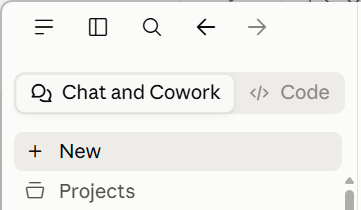

# Changes since publishing

> **Last checked:** 3 October 2026

- [Changes since publishing](#changes-since-publishing)
- [Chapter 1.4 Have Your First Useful Conversation by Typing, Talking, or Showing](#chapter-14-have-your-first-useful-conversation-by-typing-talking-or-showing)
  - [Select a model and effort level](#select-a-model-and-effort-level)
- [Chapter 2.2 Choose the Right Mode for Each Task](#chapter-22-choose-the-right-mode-for-each-task)
  - [Figure 2.2B: The mode selectors in the Claude desktop app](#figure-22b-the-mode-selectors-in-the-claude-desktop-app)
- [Sources](#sources)

# Chapter 1.4 Have Your First Useful Conversation by Typing, Talking, or Showing

## Select a model and effort level

Here's a table of selective Claude models and versions (I have excluded less important ones) that were released from October 2025 to October 2026 and notes about why they are relevant:

| Date | Model | Tier | Notes |
|---|---|---|---|
| 15 Oct 2025 | Haiku 4.5 | Haiku | Currently the small/fast tier model. Haiku 5.5 has been announced and is due within weeks. |
| 16 Apr 2026 | Opus 4.7 | Opus | Point release ahead of the 4.8 update. Note the six-week gap between minor point releases (4.7 to 4.8). |
| 28 May 2026 | Opus 4.8 | Opus | Anthropic called it a "modest but tangible" improvement over 4.7, with a focus on reducing unsupported claims/overconfidence; same pricing as 4.7. |
| 9 Jun 2026 | Fable 5 & Mythos 5 | Mythos | First "Mythos-class" models. Fable 5 is the generally available version with added safety classifiers for cybersecurity/biology/model-distillation topics; Mythos 5 is the same underlying model without those extra guardrails, limited to vetted orgs via Project Glasswing. |
| 30 Jun 2026 | Sonnet 5 | Sonnet | Became the new default model for Free and Pro plans; pitched as "the most agentic Sonnet," with performance closer to Opus-class at Sonnet pricing. |
| 24 Jul 2026 | Opus 5 | Opus | Described as coming close to Fable 5's frontier intelligence at roughly half the price; became the default model on Claude Max. |
| 1 Sep 2026 | Fable 5.1 & Mythos 5.1 | Mythos | Fable 5.1 is generally available; Mythos 5.1 is invite-only for vetted cybersecurity/life-sciences organizations. Headline pricing unchanged. |
| 22 Sep 2026     | Opus 5.5               | Opus   | First model in the 5.5 family. Anthropic positions it at roughly Fable 5.1-level performance on most work at about 40% lower cost than Opus 5 ($4/$20 per million tokens), with a 1M-token context window. |
| 28 Sep 2026     | Sonnet 5.5               | Sonnet   | Second model in the 5.5 family. Anthropic describes it as a clear upgrade over Sonnet 5 that runs at least 30% faster and costs up to 30% less per task, at the same list price ($2/$10 per million tokens). Thinking cannot be turned off for it in the Claude apps. Sonnet 5.5 is the first Sonnet with cybersecurity safeguards. Higher-risk security requests visibly fall back to Sonnet 5. [Why Claude switched models in your conversation with Sonnet 5.5](https://support.claude.com/en/articles/17161993-why-claude-switched-models-in-your-conversation-with-sonnet-5-5) |

# Chapter 2.2 Choose the Right Mode for Each Task

## Figure 2.2B: The mode selectors in the Claude desktop app

In the print book, the mode selector uses **Home**, as shown in *Figure 2.2B*:

The newer version of Claude uses **Chat and Cowork** instead:

> **Warning!** Anthropic announced on September 16, 2026 that it plans to merge Cowork and Chat. Anthropic says they are becoming one Claude, with Docs, Slides and Design built into conversations too (initially in beta). This change is rolling out to plans over late September and October 2026. Personally, I have not yet been updated, as of September 24, 2026.

# Sources

- [Claude Support Help Center release notes](https://support.claude.com/en/articles/12138966-release-notes)