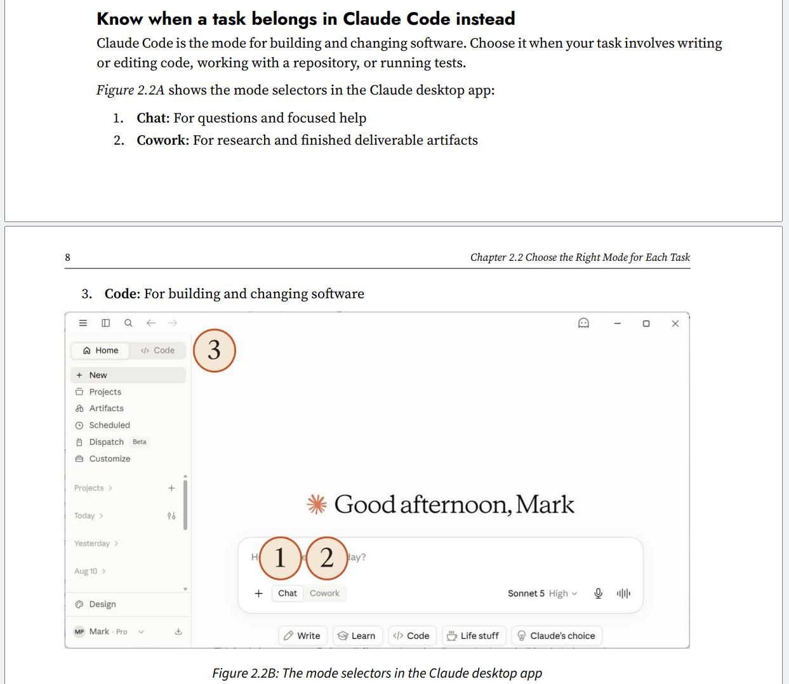

# Changes for *Claude Visual Bible*

> **Last checked:** 30 October 2026

- [Changes for *Claude Visual Bible*](#changes-for-claude-visual-bible)
- [Chapter 1.4 Have Your First Useful Conversation by Typing, Talking, or Showing](#chapter-14-have-your-first-useful-conversation-by-typing-talking-or-showing)
  - [Select a model and effort level](#select-a-model-and-effort-level)
  - [Claude Haiku 4.5 has left the model selector](#claude-haiku-45-has-left-the-model-selector)
- [Chapter 2.2 Choose the Right Mode for Each Task](#chapter-22-choose-the-right-mode-for-each-task)
  - [Figure 2.2B: The mode selectors in the Claude desktop app](#figure-22b-the-mode-selectors-in-the-claude-desktop-app)
- [Other changes since September 2026](#other-changes-since-september-2026)
  - [Docs, Slides, and Design in any conversation](#docs-slides-and-design-in-any-conversation)
  - [Claude Dashboards and Claude Motion (beta)](#claude-dashboards-and-claude-motion-beta)
  - [Claude Duet (research preview)](#claude-duet-research-preview)
  - [Plans and billing](#plans-and-billing)
  - [Plugins and connectors](#plugins-and-connectors)
  - [Team and Enterprise features](#team-and-enterprise-features)

# Chapter 1.4 Have Your First Useful Conversation by Typing, Talking, or Showing

## Select a model and effort level

Here's a table of Claude models and versions that were released from April 2026 to October 2026 and notes about why they are relevant:

| Date             | Model                  | Tier   | Notes                                                                                                                                                                                                    |
| ---------------- | ---------------------- | ------ | -------------------------------------------------------------------------------------------------------------------------------------------------------------------------------------------------------- |
| Apr 16, 2026     | Opus 4.7               | Opus   | Point release ahead of the 4.8 update. Note the six-week gap between minor point releases (4.7 to 4.8).                                                                                                  |
| May 28, 2026     | Opus 4.8               | Opus   | Anthropic called it a "modest but tangible" improvement over 4.7, with a focus on reducing unsupported claims/overconfidence; same pricing as 4.7.                                                       |
| Jun 9, 2026      | Fable 5 & Mythos 5     | Mythos | First "Mythos-class" models. Fable 5 is the generally available version with added safety classifiers for cybersecurity/biology/model-distillation topics; Mythos 5 is the same underlying model without those extra guardrails, limited to vetted orgs via Project Glasswing. |
| Jun 30, 2026     | Sonnet 5               | Sonnet | Became the new default model for Free and Pro plans; pitched as "the most agentic Sonnet," with performance closer to Opus-class at Sonnet pricing.                                                      |
| Jul 24, 2026     | Opus 5                 | Opus   | Described as coming close to Fable 5's frontier intelligence at roughly half the price; became the default model on Claude Max.                                                                          |
| Sep 1, 2026      | Fable 5.1 & Mythos 5.1 | Mythos | Fable 5.1 is generally available; Mythos 5.1 is invite-only for vetted cybersecurity/life-sciences organizations. Headline pricing unchanged.                                                            |
| Sep 22, 2026     | Opus 5.5               | Opus   | First model in the Claude 5.5 family. Anthropic says it performs at the level of Fable 5.1 on most work and costs 40% less to run than Opus 5 on typical workloads.                                   |
| Sep 28, 2026     | Sonnet 5.5             | Sonnet | Second model in the 5.5 family. A faster, lower-cost complement to Opus 5.5: Anthropic says it runs 30%+ faster than Sonnet 5 and costs up to 30% less for most work.                                  |
| Oct 7, 2026      | Haiku 5.5              | Haiku  | Replaces Haiku 4.5 as the small/fast tier model. Anthropic calls it the cheapest, fastest, and most capable small model it has released. 1M token context window.                                      |

## Claude Haiku 4.5 has left the model selector

On **October 29, 2026**, Anthropic removed Claude Haiku 4.5 from the model selector in chat, Claude Cowork, and Claude Design on the Free, Pro, and Max plans, including in Claude Desktop and Claude Mobile. Claude Haiku 5.5 replaces it.

- If Haiku 4.5 was your selected model, Claude switches you to Haiku 5.5.
- Your existing Haiku 4.5 chats are kept. If you continue one, Haiku 5.5 answers.
- Haiku 4.5 is still available in Claude Code, on Team and Enterprise plans, and on the Claude Platform (API).

To change the model in a chat, click the model name next to the send button, and then select a model, or click **More models** to see more options.

Source: [Claude Haiku 4.5 is leaving the model selector – Claude Help Center](https://support.claude.com/en/articles/17444146-claude-haiku-4-5-is-leaving-the-model-selector)

# Chapter 2.2 Choose the Right Mode for Each Task

## Figure 2.2B: The mode selectors in the Claude desktop app

In the print book, the mode selector uses **Home**, as shown in *Figure 2.2B*:

Since **September 16, 2026**, Anthropic has been rolling out a new experience that merges chat and Claude Cowork into a single conversation. You no longer choose a mode before you start. You just ask for what you need, and Claude decides whether to answer quickly or work through a bigger task, such as research, a report, a spreadsheet, or a presentation.

**How to tell whether you have it:** If your message box still shows **Chat** and **Cowork** options, you don't have the new experience yet. Keep using chat and Cowork as the book describes until your account moves over. Once it does, you can't switch back.

**Who gets it:** It is rolling out gradually, starting with Pro and Max plans on web, desktop, and mobile. On Team (in beta) and Enterprise plans, it's available where an administrator has turned on **Chat and Cowork unified**.

**What stays the same:** The model picker and the **Code** tab are where they were. Your chats, Cowork tasks, projects, connectors, skills, artifacts, and files carry over.

**What has moved or changed:**

| Before | In the new experience |
| --- | --- |
| Chat and Cowork options in the message box | Gone. One conversation does both. |
| Cowork tasks listed separately | Listed with your chats in **Recents**. |
| Cowork **Global instructions** | Part of **Instructions for Claude** in **Settings > Your Claude** (or **Settings > Account** in the older Settings layout). |
| Web search toggle | Gone. Claude searches the web when it helps. |
| Research | Type `/deep-research`, or click **+** below the chat input, and then choose **Research**. |
| Permissions in Cowork | A permission setting in the message box: **Auto** (default on Pro, Max, and Team) or **Manual** (default on Enterprise). |

**Current limitations:** Add from GitHub isn't supported, you can't branch a conversation from an earlier point, and incognito chats open in the previous experience, so Claude can't create files or run code in them. Dispatch isn't available to new users.

> **Book update:** A new screenshot of the message box without the Chat and Cowork options would replace the second image above for readers who have the new experience.

Source: [Claude Cowork and chat are one Claude – Claude Help Center](https://support.claude.com/en/articles/16761823-claude-cowork-and-chat-are-one-claude)

# Other changes since September 2026

These changes don't map to a single section of the book, but readers may notice them.

## Docs, Slides, and Design in any conversation

- **September 16, 2026:** You can ask for a design, deck, or document in any conversation, including in Claude Code and the **Artifacts** tab, and then edit it with Claude or directly yourself. **Claude Design** makes on-brand visuals and mockups, **Claude Slides** makes presentations, and **Claude Docs** makes living documents you write with Claude and your team.
- **October 8, 2026:** Docs, Slides, and Design came out of beta and are available on every plan, including Free. On Enterprise plans, they turned on by default on October 15, 2026.
- The standalone Claude Design site (claude.ai/design) closes on **December 14, 2026**. Claude Design now works inside your conversations instead.

Sources: [Release notes – Claude Help Center](https://support.claude.com/en/articles/12138966-release-notes), [Claude Dashboards and Motion enter beta – AI Catchup](https://aicatchup.com/news/claude-dashboards-motion-beta)

## Claude Dashboards and Claude Motion (beta)

On **October 8, 2026**, Anthropic launched two new artifact types in beta:

- **Claude Dashboards** (paid plans): Ask a question in plain language, and Claude builds a live dashboard from your connected company data, such as Snowflake, BigQuery, Databricks, Amazon Redshift, ClickHouse, or Salesforce.
- **Claude Motion** (Team and Enterprise plans): Turns reports, charts, and product walkthroughs into short animated explainers that you can edit and export as MP4 files.

On Enterprise plans, both are off by default until an administrator turns them on.

Sources: [Claude Dashboards and Motion enter beta – AI Catchup](https://aicatchup.com/news/claude-dashboards-motion-beta), [Anthropic launches Dashboards and Motion – Unite.AI](https://unite.ai/anthropic-launches-claude-dashboards-and-motion-takes-docs-out-of-beta)

## Claude Duet (research preview)

On **October 21, 2026**, Anthropic opened a research preview of **Claude Duet**, a separate app in which Claude works as a proactive agent. It:

- comes to you with what needs your attention, such as a morning briefing from your inbox and calendar
- completes tasks you give it, and keeps working in the cloud when you step away
- asks for your approval before important actions, such as sending messages, making payments, or signing documents

It runs on Opus 5.5, uses the apps, memory, and skills already set up in your Claude account, and shares your plan's usage limits. The preview is waitlist-only for Pro and Max subscribers in the United States, on iOS, Android, and claude.ai.

Sources: [Release notes – Claude Help Center](https://support.claude.com/en/articles/12138966-release-notes), [Claude Duet research preview – Let's Data Science](https://letsdatascience.com/news/anthropic-opens-claude-duet-research-preview-for-proactive-a-16522f5d)

## Plans and billing

- **October 7, 2026:** Max and Team plans now include **monthly API credits** for running your own apps and agents on the Claude Platform. To claim them, link a Claude Console organization in **Settings > Billing** (Max) or **Organization settings > Billing** (Team).

Source: [Release notes – Claude Help Center](https://support.claude.com/en/articles/12138966-release-notes)

## Plugins and connectors

- **September 15, 2026:** **Salesforce in Claude** (beta) brings a seller's accounts, opportunities, and pipeline into Claude, with 37 pre-built sales skills. It's on all paid plans, for organizations that Salesforce approves through its beta sign-up.
- **September 25, 2026:** Developers can now submit plugins to the Claude directory through a new developer portal, track them through review, and see usage analytics.
- **October 6, 2026 (reported):** Claude for Google Workspace entered public beta on paid plans, letting Claude create and edit in Google Docs, Sheets, and Slides. This comes from third-party reporting and isn't in Anthropic's release notes, so check it before relying on it.

Sources: [Release notes – Claude Help Center](https://support.claude.com/en/articles/12138966-release-notes), [What are the new features of Claude? – The Oxford AI School](https://www.theoxfordaischool.com/new-features-of-claude)

## Team and Enterprise features

- **September 10, 2026:** **Smart reports** (beta, Enterprise) analyze how a team uses Claude: the work getting done, what it costs, where sessions run into friction, and which repeated patterns are worth turning into shared skills.

Source: [Release notes – Claude Help Center](https://support.claude.com/en/articles/12138966-release-notes)
